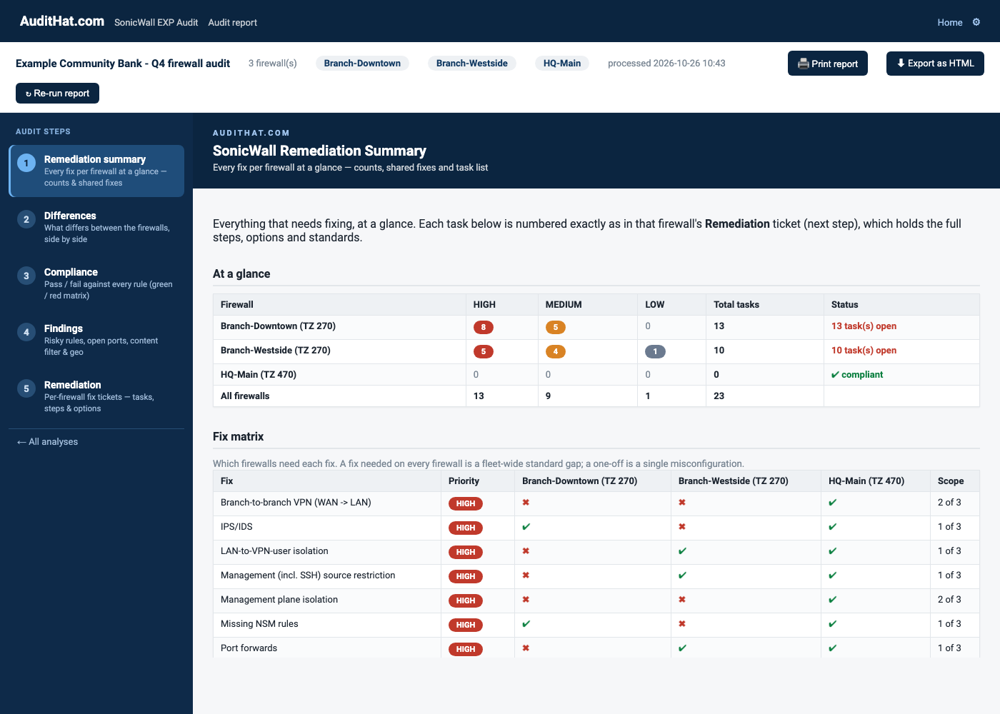
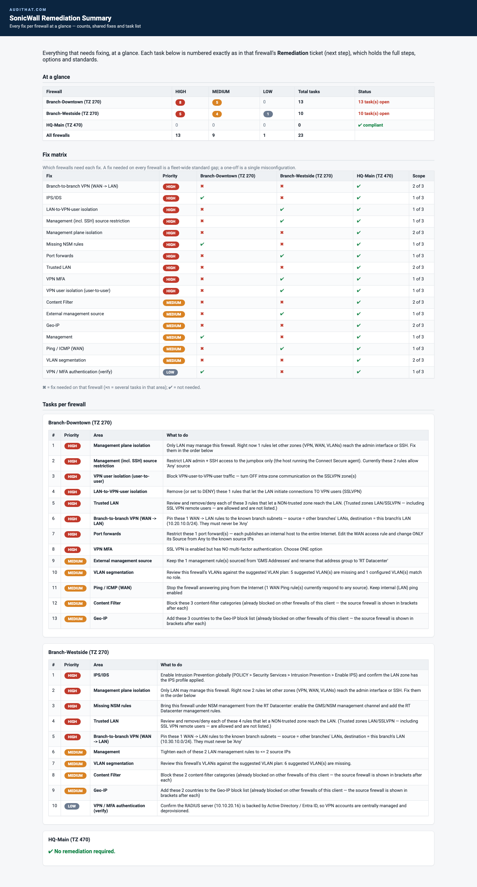
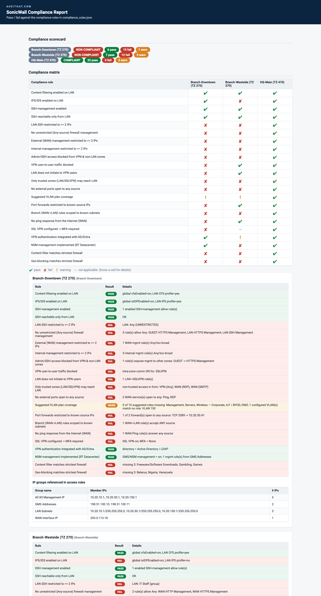
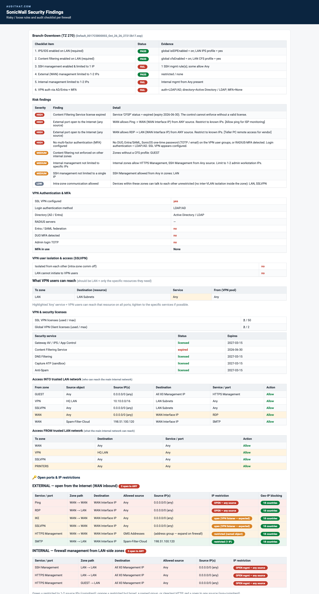
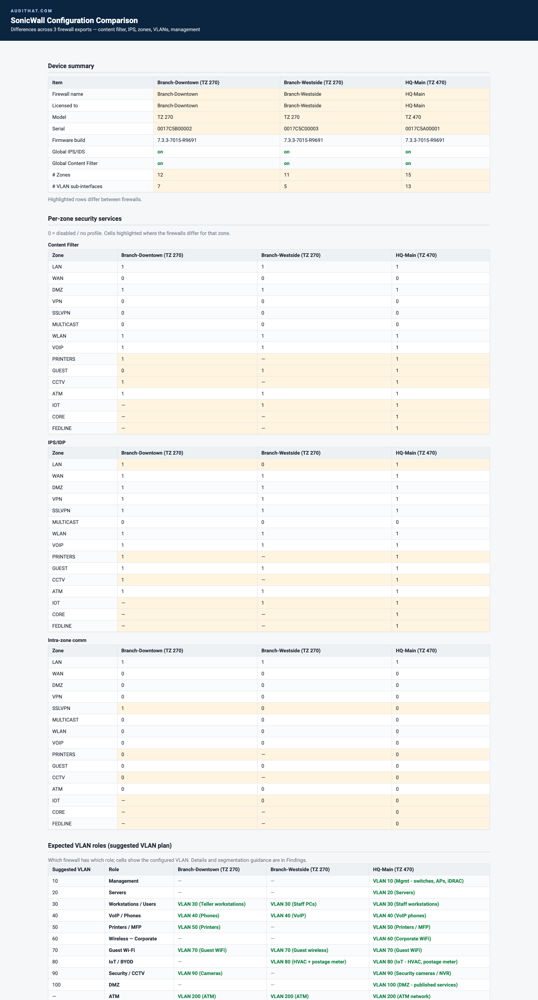
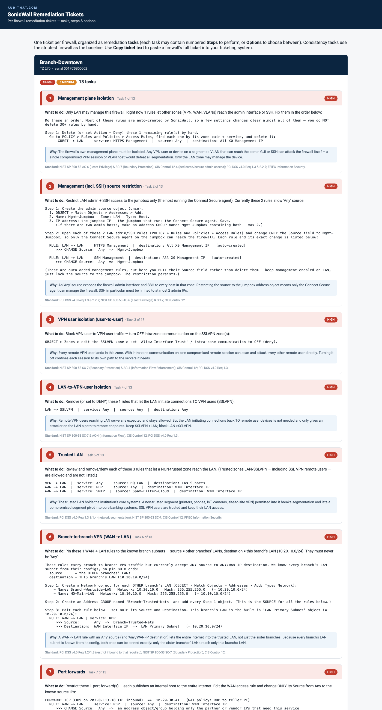
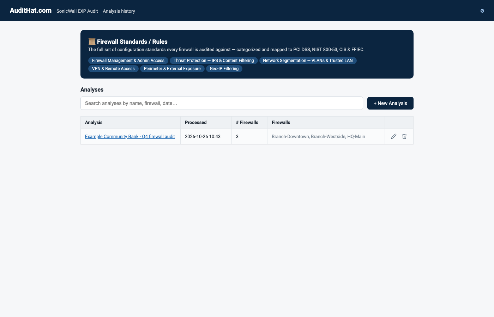

# SonicWall EXP Comparison & Audit

A simple, well-designed web app for auditing a whole fleet of SonicWall
firewalls from their EXP config exports. Drag in **10+ exports at once** and it
lines the firewalls up side by side, highlights every setting that differs,
grades each one against a written standard, and writes the ticket-ready steps
to bring them all into the **same, compliant configuration**. Every audit is
kept in a searchable history, so you can reopen last quarter's results, re-run
after the fixes are made, and show exactly what changed.

Built by [AuditHat.com](https://audithat.com) for **banks and credit unions**.
It checks **content filtering**, **IPS/IDS**, **VLAN segmentation**,
**management access restrictions**, VPN authentication and MFA, port forwards,
and Geo-IP blocking across every firewall for a client, and produces colorized
HTML reports.

Every finding is tied to the standard it affects (PCI DSS, NIST SP 800-53, CIS
Controls, FFIEC Information Security), so the remediation tickets double as
examiner-ready evidence. The tool is built to help institutions **maintain
FFIEC and GLBA compliance between exams**, not just pass one: run it after every
firewall change, hand the ticket list to whoever makes the fix, re-run to
confirm.

Repo: https://github.com/ryanerb4/SonicWall-Firewall-EXP-Config-Standards-Analyzer

## Getting started
```
git clone https://github.com/ryanerb4/SonicWall-Firewall-EXP-Config-Standards-Analyzer.git
cd SonicWall-Firewall-EXP-Config-Standards-Analyzer
```
Python 3 only — no third-party packages required.

## What the reports look like
The repo ships a **fictional sample data set**: three firewalls for an invented
community bank (`HQ-Main`, `Branch-Downtown`, `Branch-Westside`). HQ is a
hardened reference config; the two branches carry typical findings (open
management, an RDP port forward from the Internet, no VPN MFA, an expired
license, legacy "Any" rules). Nothing in it comes from a real firewall; public
IPs use the RFC 5737 documentation ranges.

- `samples/exp/*.zip`: the synthetic EXP exports. Upload them in the web app
  (or drop them in `input/`) to see a full analysis in seconds.
- `samples/reports/*.html`: the five reports the tool produced from them.
- `samples/screenshots/*.png`: full-page captures of each report.
- `python3 samples/make_samples.py` regenerates all of the above
  (`--screenshots` also re-captures the PNGs with headless Chrome).

**Web app, analysis screen** (remediation summary shown first):



Click a thumbnail for the full-page capture:

| Remediation summary | Compliance matrix |
|---|---|
| [](samples/screenshots/summary.png) | [](samples/screenshots/compliance.png) |
| **Findings** (checklist, risk findings, open ports) | **Differences** (zones, VLAN plan, licenses side by side) |
| [](samples/screenshots/findings.png) | [](samples/screenshots/differences.png) |
| **Remediation tickets** (steps, why, standard) | **Web app home** (analysis history) |
| [](samples/screenshots/remediation.png) | [](samples/screenshots/app-home.png) |

## Web app (recommended)
```
python3 app.py
```
Opens a local web UI (http://127.0.0.1:8765, or the next free port if that
one is busy — the exact URL is printed):
- **Home** — analysis history, newest first, with search bar and processed
  dates. Click an analysis to reopen its reports; delete removes it.
- **New Analysis wizard** — name the analysis, drag & drop the EXP `.zip`
  files (10+ supported), click Process.
- **Report screen** — Remediation summary shown first; left menu switches to
  Differences, Compliance, Findings, and **Remediation tickets**. Each ticket item lists the
  explicit offending rules / missing categories / missing countries, plus a
  plain-English **Why** and the **standard failing** (PCI DSS, NIST 800-53, CIS
  Controls, FFIEC), and a "Copy ticket text" button that copies the full
  per-firewall text (with Why + standard).

Each analysis is stored under `data/analyses/<id>/` (uploads, decoded configs,
SQLite DB, reports). Everything stays local.

## CLI (no web UI)
1. Drop each firewall's EXP download (`.zip`) into `input/`
2. Run:
   ```
   python3 sonicwall_compare.py
   ```
3. Open the reports in `output/`:
   - **compliance.html** — colorized rules **pass/fail** report: scorecard with
     per-firewall COMPLIANT/NON-COMPLIANT verdict, a rules × firewalls
     **compliance matrix** (green/red/orange/gray cells), per-firewall detail
     with evidence, the **IP groups** referenced in rules (name → member IPs),
     and cross-firewall **consistency exceptions**.
   - **differences.html** — what differs between the firewalls.
   - **findings.html** — risky/loose rules, open ports, content filter, geo.
   - **summary.html** — remediation at a glance: task counts per firewall,
     fix matrix (shared vs. one-off fixes), compact task list.
   - **remediation.html** — per-firewall ticket-ready fix lists.

Compliance rules live in **`compliance_rules.json`** — edit it to change the
policy (trusted zone, SSH/management IP limits, required MFA, consistency, etc.)
without touching the code.

Everything runs locally. No data leaves this folder.

## Audit checklist (per firewall)
1. IPS/IDS enabled on LAN (required — global `isIDPEnabled` + LAN zone profile)
2. Content filtering enabled on LAN (required — global + LAN zone CFS profile)
3. SSH management enabled & limited to a single IP
4. External (WAN) management limited to 1–2 IPs
5. Internal management limited to 1–2 IPs
6. VPN authentication via AD/Entra + MFA (DUO, Entra, or SonicOS one-time
   passwords on the VPN user group; plain RADIUS = verify)

## Report sections
**findings.html** (per firewall): checklist (traffic-light pills) · risk
findings · **Open ports & IP restrictions** (EXTERNAL from Internet + INTERNAL
firewall management, each row flagged green/orange/red) · **Port forwards
(inbound NAT)** (port, inbound interface, public IP, internal target, source
restriction — or "no port forwards") · VPN Authentication &
MFA · VPN & security licenses · Access INTO / FROM trusted LAN · **Content
filter blocked categories** · **Geo-IP blocked countries** · expected VLAN role
coverage.

**differences.html**: device summary (firewall names) · global flags · per-zone
CFS/IPS/intra-zone matrix · VLAN inventory · management posture · VPN auth ·
Security & VPN license counts · content-filter/Geo-IP comparison.

## Traffic-light coloring (open ports)
- **green** — restricted to 1–2 source IPs (compliant)
- **orange** — restricted but broad / named group / cleartext HTTP / expected
  VPN listener (IKE, SSL VPN)
- **red** — open to any source (non-compliant)

LAN is treated as the **Trusted** network. Firewalls are identified by their
configured name (`firewallName`, e.g. MainBranch / NorthBranch).

## Geo-IP country decode
The blocked-country list is decoded from the `geoInitBitmap` bitmap
(bit position = low byte of each country's `countryObjIndex`, MSB-first).
Validated against the block-unknown flag (Anonymous-Proxy / Other-Country bits
set) and the OFAC/high-risk cluster (China, Iran, N. Korea, Russia, Syria, …).
Spot-check against the firewall UI (Security Services → Geo-IP Filter).

## Files
- `sonicwall_compare.py` — main tool (parse → SQLite → reports)
- `exp_parser.py` — decodes SonicOS 7.x EXP (zip → base64 → `key=value`)
- `inspect_exp.py` — format detector (diagnostic only)
- `data/decoded/*.txt` — human-readable dump of each config
- `data/sonicwall.db` — SQLite of parsed zones / interfaces / mgmt rules

## Tuning
- Expected VLAN roles (suggested VLAN plan — id, role, purpose, match patterns,
  segmentation): `expected_vlan_roles` in `compliance_rules.json`
- Zones exempt from the content-filter check: `NON_CFS_ZONES`

## Notes / limitations
- Verified against SonicOS 7.3.3 (TZ 370). Other 7.x builds should work; if a
  future export fails, run `python3 inspect_exp.py` to re-check the format.
- Management "limited to 1–2 IPs" is evaluated from firewall **access rules**
  (`policyDstSvc = *Management`). Host/range/network source objects are resolved
  to exact IP counts; **address _groups_** are treated as "specific" but their
  member count isn't expanded yet — worth spot-checking named groups by hand.

## About the author
Written by Ryan Erb — [erb.one](https://erb.one). Part of the
[AuditHat.com](https://audithat.com) toolset for bank and credit union IT
audits.

## License
Apache License 2.0 — see `LICENSE`.
